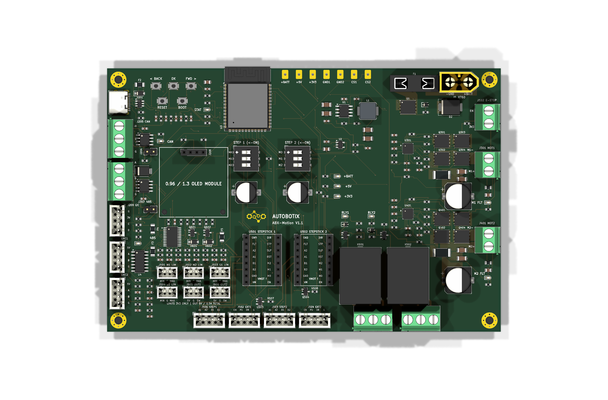
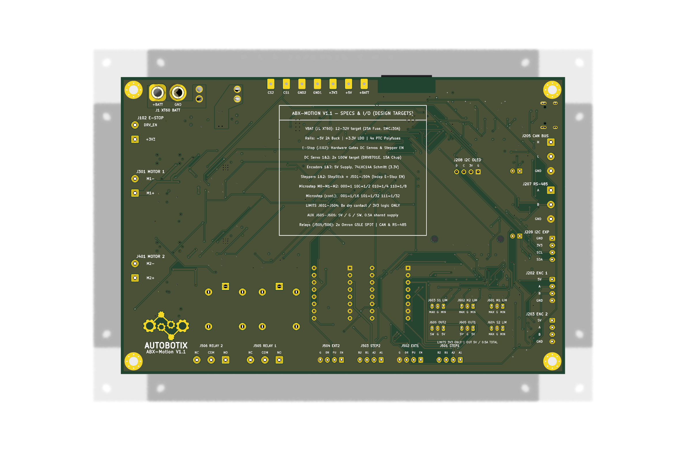

# ABX-Motion V1.1 prototype controller

Compact **157 × 105 mm, four-layer** ESP32-S3 motion controller. This layout is
intended for controlled prototype testing. Printed voltage, motor-power and
fuse ratings are design targets, not measured board ratings.

## Hardware

- ESP32-S3-WROOM-1-N8R2, native USB-C programming, RESET/BOOT buttons,
  CAN, RS-485, I²C OLED header and BACK/OK/FWD controls.
- Two DRV8701E brushed-motor bridges with encoder inputs, 10 mΩ shunts
  and configurable gate-drive resistors.
- Two StepStick sockets and external STEP/DIR/EN connectors. Check each
  carrier's pinout, enable polarity, voltage range and mode straps before use.
- Two SPDT relays. Contact ratings do not establish PCB current capability.
- XT60 input, Keystone 3557-2 fuse holder, reverse-polarity P-MOSFET,
  SMCJ30A TVS, 5 V buck and 3.3 V LDO.
- Front and rear exposed-copper gears (`F.Cu`/`F.Mask` and `B.Cu`/`B.Mask`)
  with white silkscreen text (`AUTOBOTIX` / `ABX-Motion V1.1`). Select ENIG for
  gold artwork.

## Compact I/O

J601–J606 use identical three-pin JST-PH headers. Read the per-pin markings:
output headers have a different function from limit headers.

| Headers | Channel | Pin 1 | Pin 2 | Pin 3 |
| --- | --- | --- | --- | --- |
| J601 | DC motor 1 limits | MIN | GND | MAX |
| J602 | DC motor 2 limits | MIN | GND | MAX |
| J603 | Stepper 1 limits | MIN | GND | MAX |
| J604 | Stepper 2 limits | MIN | GND | MAX |
| J605 | Auxiliary output 1 | +5V_OUT | GND | SW1 |
| J606 | Auxiliary output 2 | +5V_OUT | GND | SW2 |

The eight limit channels have 3.3 V pull-ups, series resistors and RC filtering.
Use dry contacts to ground or compatible 3.3 V logic. **Do not connect 12/24 V
sensors directly.** Normally closed contacts let firmware treat a broken wire
as an active limit. Configured as outputs, these are resistor-limited logic
signals, not load drivers.

Connect a 5 V auxiliary load between +5V_OUT and SW1/SW2. SW pins are low-side
MOSFET drains. Both headers share F5: **Littelfuse 1206L050/15YR, C151162**,
500 mA hold at 20 °C, 15 V. The PTC is not a precise 500 mA current limiter;
temperature, trip delay and the total 5 V supply budget constrain usable loads.

## Firmware and stopping

PCA9555 U601 is at I²C address 0x20 on GPIO41 (SDA) / GPIO42 (SCL).
Its active-low interrupt uses GPIO36; BACK uses GPIO21.
Port 0 bits 0–7 are limits in the table's MIN/MAX order.
Port 1 bits 0/1 command auxiliary outputs, bits 2/3 command active-low
stepper enables, and bit 4 reads E-stop status. Bits 5–7 are grounded and
must remain inputs.

On startup, keep both ports as inputs, write Port 1 output latch **0x0C**
(outputs off, steppers disabled), then configure Port 1 with **0xF0**. Keep
Port 0 configuration **0xFF** for limit sensing. Read inputs to acknowledge
interrupts. An ESP32 reset does not reset the independently powered expander;
reinitialize it on every boot and test reboot behavior under load. No application
firmware is supplied in this repository yet.

The hardware E-stop net disables DC bridges and gates onboard/external
stepper enables. Relays and auxiliary outputs remain powered. Verify stop
behavior with each actual attached driver. Firmware must block travel into an
active limit while allowing controlled retreat; I²C limit sensing is not an
independent hardware overtravel interlock.

## Validation and first power-up

See `validation/final-rear-gold-20261020/review.txt` for independent checks,
assembly caveats and source hashes. Use matching files in
`production/final-rear-gold-20261020/`; older timestamped exports describe older
boards. Approve pin 1, polarity and connector mating direction in the
assembler's placement review (especially `U601` and `J601–J606`).

Start with a current-limited 12 V bench supply, motors disconnected and drivers
disabled. Check rails, USB programming, expander defaults, all eight inputs,
auxiliary outputs and E-stop before adding one unloaded motor at low current.
Measure switching transients, rail ripple, current accuracy and temperatures
before increasing voltage or load. SMCJ30A's specified surge clamp can exceed
the DRV8701's 47 V absolute maximum, so 32 V operation is not qualified.
Q1 heating, LDO dissipation and motor-capacitor ripple capability also need
measurement. Confirm the OLED module's physical hole/header dimensions before
ordering (`H5`/`H6` M2 holes are at `23.30 mm` actual X spacing vs `23.0 mm`
nominal silkscreen callout, `23.80 mm` below `J208`); SSD1306 module names do
not guarantee a common hole pattern.
